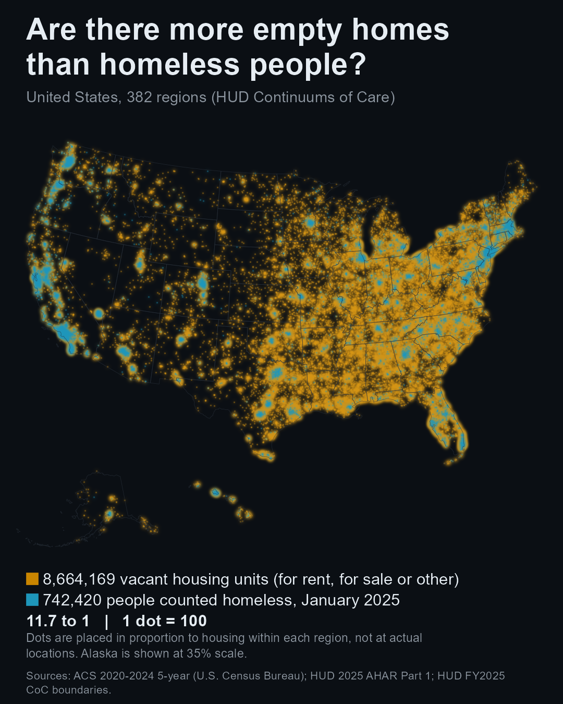

# Contrast Maps: Map 1, empty homes vs. homeless people

A series of data maps that test a public claim by pairing two layers in tension. Map 1 tests this claim, restated neutrally: *there are more empty homes in the U.S. than homeless people.*

Stance: **advocate**. My view is that price and policy, not a lack of buildings, is the main barrier to housing people. That is my reading and is kept separate from the findings below. The data was not bent to fit it, and one result complicates it.

## Result

| Test | Verdict |
|---|---|
| Claim 1: narrow-definition vacant units outnumber people counted homeless | **Supported.** 8,665,393 vs 742,420 nationally (11.7 to 1); true in 382 of 382 Continuum of Care (CoC) regions on point estimates. |
| Claim 1b: rent level and low vacancy track the homelessness rate | **Mixed.** Rank correlation 0.28 (rent), -0.10 (vacancy); the pre-registered bar was 0.3. |
| Claim 1c: rent burden tracks the homelessness rate | **Mixed.** Rank correlation 0.29, just under the bar. |
| S1 (post hoc, not pre-registered) | With 90% margins of error, 381 of 382 regions still hold; Lynn, MA (1.04 to 1) is too close to call. |
| ACS 2024 1-year national check (pre-registered, run late) | 11.5 to 1; same conclusion. |

The ratio varies a lot by region: 1.04 to 231 to 1 (median 18.5).

**What the map cannot show:** that the empty units could house these people. They may be in the wrong place, in poor condition, or unaffordable. The homeless count is a one-night January snapshot and is known to undercount. Dot positions are modeled (placed in proportion to housing within each region), not measured. A map can show a mismatch; it cannot show cause.

## Data (full URLs and pull dates in `data-sources.md`)

- U.S. Census Bureau, American Community Survey 2020-2024 5-year, tract tables (B25002, B25004, B25064, B01003, B25070), via `tidycensus`.
- HUD 2025 Annual Homelessness Assessment Report, Part 1: Point-in-Time counts by CoC (January 2025).
- HUD FY2025 Continuum of Care boundaries.

This product uses the Census Bureau Data API but is not endorsed or certified by the Census Bureau.

## Read in this order

1. `map1-preregistration.md` and the amendments (`map1-preregistration-amendment-1.md` to `-5.md`, `map1-preregistration-claim-1c.md`): the test, written before looking at results, and every change made along the way.
2. `map1-results-log.md`: results as they came in, including the refinements tried after the mixed results.
3. `map1-methodology.md`: method, limits, what changed, data currency and the corrections log.
4. `map1-spec.md`: build and publishing spec.
5. `data-sources.md`: every source with URL and date pulled.

## Reproduce

R-first (`sf`, `ggplot2`, `tidycensus`, `ragg`); video encoding uses ffmpeg. Scripts in `map1/` are numbered in run order:

- `01`-`07`: Michigan pilot, then the national pull and CoC join (there is no script `03`).
- `08`-`11`: rent, population and rent-burden pulls; claims 1b and 1c.
- `12`-`15`: spec numbers, margin-of-error check, scatter plots, water check.
- `16`: dot generation (1 dot = 100, fixed seed).
- `17`-`19`: the still, the video frames and the carousel.
- `20`: ACS 2024 1-year national check.

A Census API key is needed for the pull scripts. See `map1-methodology.md`, "Reproduce", for details.

## Outputs

`map1/out/` holds the still (4:5), the 20-second vertical reveal video, and five carousel slides. The video fades the layers in for effect; it is not a time series.

## Status

Built 2026-10-14; not yet published. The corrections log in `map1-methodology.md` records any change after publication. Data will be rerun when the 2021-2025 ACS 5-year and a newer HUD count are released.

## License

The code (R scripts) is released under the MIT License; see `LICENSE`.

The map images, video and carousel slides in `map1/out/` and the written analysis are © 2026 willcharris, all rights reserved. Please ask before reusing them. The underlying data belongs to its publishers (U.S. Census Bureau, HUD) under their own terms.
